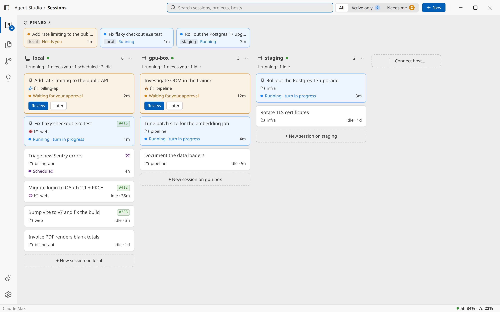
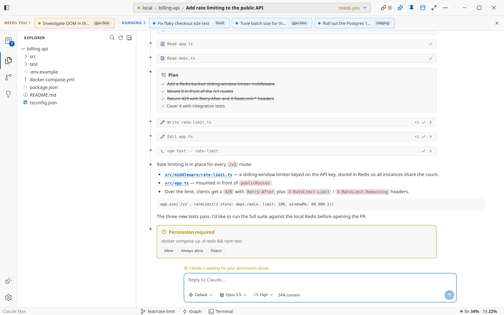
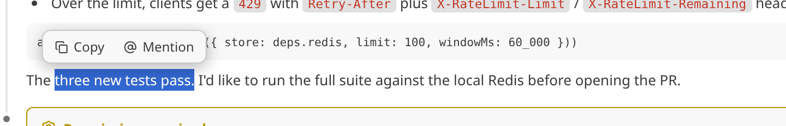
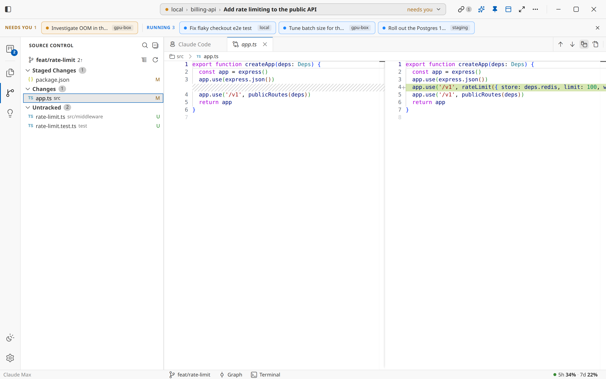

# Agent Studio

Agent Studio is a desktop app for running many Claude coding agents at once, across
your own machine and any number of SSH hosts. Start a session in any project, chat
with the agent as it reads, edits, and runs your code, and review every change in a
familiar VS Code–style workspace. A sessions board keeps every session in view, so
you can see which ones are working, which are idle, and which are waiting on you.

Under the hood it drives real Claude agent sessions over the
[Agent Client Protocol](https://agentclientprotocol.com) (ACP), backed by a
deployable session engine, and is built with Electron + React + TypeScript with a
UI modeled on the VS Code agent sessions window.



## Features

### Run many sessions, everywhere
- **Sessions board** — every session on one screen, one column per host (local and
  each SSH host). Cards show the live state (running, needs you, scheduled, idle),
  with **Review** / **Later** buttons on sessions waiting for an answer. Filter by
  *Active only* or *Needs me*, or search by session, project, or host
- **Work locally or over SSH** — connect a host and its projects and sessions appear
  next to your local ones. The session engine is installed on the remote
  automatically, and saved hosts reconnect on startup
- **Never miss a turn** — a native notification when a background session finishes
  or starts waiting for you, plus a "needs you" count on the board icon and the
  macOS dock icon
- **Organise** — pin sessions to the board's top strip, tag them (Bug, Feature,
  In review, … or your own), and see PR / ticket numbers picked up from the
  conversation as badges. Recognised ticket URLs are configurable
- **Scheduled work** — sessions that armed a `/loop` or a cron job are flagged with
  when they'll wake up next
- **Jump anywhere** — `Ctrl+Space` toggles the board, `Ctrl+E` finds a session by
  name, path, or PR / ticket number

### Chat with the agent



- Streaming replies, thinking, tool calls, plans, and diffs as the agent works
- Answer permission prompts and questions inline, or open a plan in its own tab
- Switch mode, model, and effort per session; see how full the context window is
- Slash commands with autocomplete, `@`-mention skills, paste images, and recall
  earlier prompts with ↑ / ↓
- Select text in a reply to **Copy** it or **Mention** it (quote it into your next
  message)

  

- File paths in replies open in the editor; links open in an in-app browser tab or
  your browser of choice. Mermaid diagrams render inline
- An active-sessions bar above the chat lists the other sessions that are running
  or waiting on you, one click away
- Rename sessions, regenerate their title, or restart one to pick up new host
  config (e.g. a newly added MCP server)

### Review every change



- **Source Control** — staged, changed, untracked, and conflicted files, ahead /
  behind counts, side-by-side diffs against `HEAD`, and discard
- **Branches** — switch branches and pull from the status bar, browse history in
  the branch graph
- **Editor** — a full Monaco editor to read and edit files, plus Markdown, HTML,
  image, and PDF previews
- **Terminal** — an integrated terminal in the session's folder, local or remote

### Skills
- A **Skills manager** collects Claude Code skills from every connected host into a
  local library: scan, approve, edit, and curate an active set
- A session's **Skills** tab injects library skills into its project in one go

### Also
- Light and dark themes, a command palette, and quick open
- Subscription usage in the status bar, with a warning as you cross 50% / 75%

## Install

Download the latest build for your platform from the
[Releases](https://github.com/tiepduong7c9/agent-studio/releases) page:

- **Linux (x64)** — `.AppImage`, `.deb`, or `.rpm`
- **macOS (Apple Silicon)** — `.dmg`. The app isn't notarized (ad-hoc signed only),
  so macOS blocks the first launch. Allow it under System Settings → Privacy &
  Security → **Open Anyway**, or run
  `xattr -dr com.apple.quarantine "/Applications/Agent Studio.app"`
- **Windows (x64)** — `Agent-Studio-Setup-<version>.exe`

## Prerequisites

- **Claude authentication** — Agent Studio drives Claude through the
  `@agentclientprotocol/claude-agent-acp` adapter, which reuses Claude Code's stored
  credentials (`~/.claude`, or the macOS Keychain). Log in once with the Claude Code
  CLI (or set `ANTHROPIC_API_KEY`) before starting a session. On an SSH host, log in
  on that host
- **git** on `PATH` — needed for git status, diffs, and the branch graph
- **SSH access** (optional) — only needed for remote hosts; auth via password, a
  private key file, `ssh-agent` (`SSH_AUTH_SOCK`), or the default
  `~/.ssh/id_ed25519` / `id_rsa` keys

## Session engine

Agent sessions run in `engine/` (`@agent-studio/engine`) — a standalone daemon that
exposes VS Code-style IPC channels and drives the Claude agent over ACP
(`@agentclientprotocol/claude-agent-acp`). It is packed and embedded by the app at
build time (`npm run engine`), and can also be deployed on its own so the desktop
app can attach to sessions running elsewhere. After changing anything under
`engine/src`, bump `engine`'s `VERSION` so the app stops using a stale daemon.

## Reused VS Code components

The file and changes trees are not imitations — they are VS Code's real `vs/base` widgets, imported
from monaco-editor's ESM distribution (monaco ships `vs/base/browser/ui/*` compiled):

- **Files** — `AsyncDataTree` (virtualized, lazy `IAsyncDataSource` over the project
  provider, real twisties/indent guides/selection model, keyboard navigation)
- **Changes** — `ObjectTree` with collapsible SCM-style groups
- **Editor / diffs** — Monaco, which is VS Code's editor component
- `defaultListStyles` maps the widgets onto the same `--vscode-*` CSS variables the
  app's ported theme defines

The agent window's TypeScript components themselves cannot be copied: their
transitive import closure is ~1,760 files and they resolve live workbench services
(chat, menus, commands, context keys) from the DI container at runtime — reusing
them means building all of VS Code (the fork path).

Dev aids: `STUDIO_OPEN_PATH=<dir>` auto-opens a folder, `STUDIO_SCREENSHOT=<png>`
captures the window and quits. If Electron
fails with `Cannot read properties of undefined (reading 'whenReady')`, unset
`ELECTRON_RUN_AS_NODE` (it leaks from IDE extension hosts).

The rest of the look and feel is extracted from the VS Code reference checkout in `vscode/`:

- codicon icon font (codepoints from `src/vs/base/common/codiconsLibrary.ts`)
- Light Modern / Dark Modern workbench palettes (`extensions/theme-defaults/themes/`)
- Seti file icons (`extensions/theme-seti/icons/` — seti.woff + theme json)
- git decoration colors (`extensions/git/package.json`)
- tree/list metrics and indent guides (`src/vs/base/browser/ui/tree/media/tree.css`)
- resizable sash (`src/vs/base/browser/ui/sash/sash.css`)
- editor watermark (`src/vs/workbench/browser/parts/editor/media/letterpress-light.svg`)

Note: the agent window itself is not an extractable component — it is the whole
VS Code workbench (layout.ts + DI services + contrib views), so this app recreates
its layout with the workbench's real styles instead of forking the build.

Projects can live on the **local disk** or on an **SSH remote** — both are served
through the same `ProjectProvider` interface (`src/main/providers/`):

- `LocalProjectProvider` — Node `fs` + the `git` CLI
- `SshProjectProvider` — `ssh2` SFTP for the file tree, `git` over ssh exec for status.
  Auth via password, a private key file, ssh-agent (`SSH_AUTH_SOCK`), or the default
  `~/.ssh/id_ed25519` / `id_rsa` keys. Remote paths support a `~/` prefix.

## Develop

Building from source needs **Node.js 20+** and **npm**, plus a C/C++ toolchain
(build-essential / Xcode CLT / MSVC build tools) — `npm install` rebuilds the native
`node-pty` module for Electron.

```bash
npm install
npm run dev                 # hot-reloading dev app
STUDIO_OPEN_PATH=/some/dir npm run dev   # auto-open a folder on launch
npm run typecheck
```

## Build / package

```bash
npm run build               # compile to out/
npm run package             # unpacked app in release/
npm run dist                # installers for the current OS in release/
```

Pushing a `v*` tag runs the release workflow (`.github/workflows/release.yml`),
which builds Linux x64 (AppImage, deb, rpm), macOS arm64 (dmg), and Windows x64
(nsis) and publishes them to a GitHub release.

## Screenshots

The images in `docs/screenshots/` are rendered from sample data — the renderer runs
in a plain browser against a mocked `window.studio` (no Electron or engine needed).
To regenerate them, see [`scripts/screenshots/`](scripts/screenshots/README.md).

## Layout

```
src/
  main/        Electron main process
    providers/ local & ssh project providers (ProjectProvider interface)
    git/       porcelain v2 status parser
    ipc.ts     IPC handlers (Result<T> envelopes)
  preload/     contextBridge API (window.studio)
  renderer/    React UI (TitleBar, panels, FileTree, GitPanel, AcpThread, TerminalView, …)
  shared/      types shared across processes (incl. ACP protocol types)
engine/        session engine daemon
  src/acp/     ACP session manager + Claude agent driver
  src/channels/  VS Code-style IPC channels
```

The `vscode/` folder is a reference checkout of VS Code and is not part of the build
(it is git-ignored).
